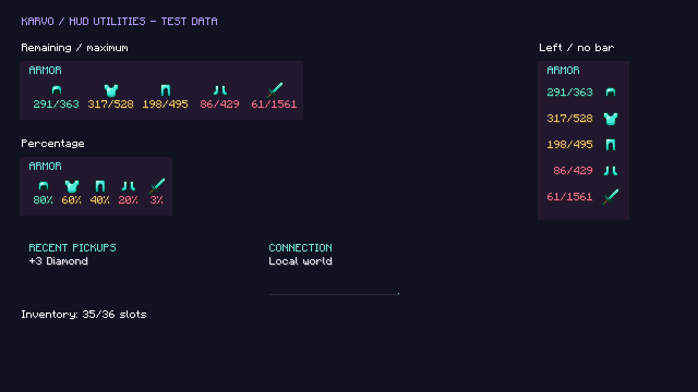
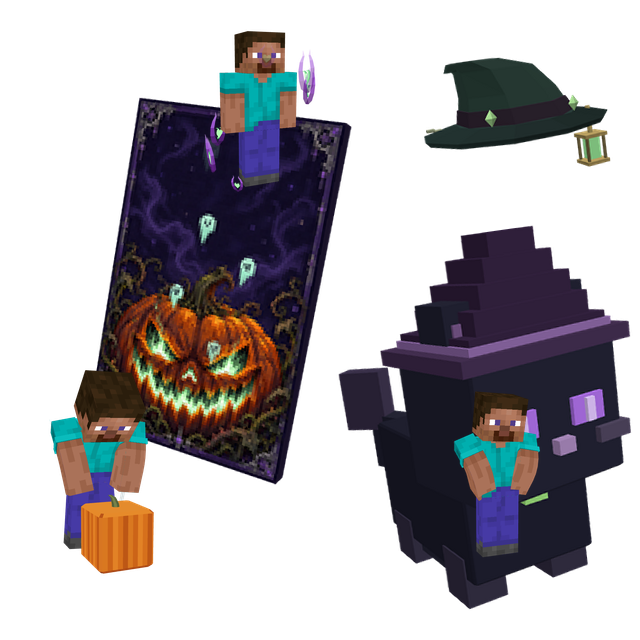

# Karvo media kit

## Approved factual description

Karvo LaunchPad is a Minecraft Java Edition launcher and integrated client supporting 1.8.9, 1.12.2, 1.21.1 and 26.2. It includes customisable HUD tools, account management, cosmetics and an equipped-emote wheel. The launcher is available for Windows, Linux and macOS. Optional cosmetics and Karvo+ are paid separately. Minecraft Java Edition ownership is required.

Website: https://karvobot.uk/launchpad/ · Downloads: https://github.com/dev2cge/KarvoLaunchPad-Releases/releases/latest

## Preview assets

The HUD image is a native client test screen using test inventory values, not a live multiplayer screenshot or FPS benchmark.

The bundle image uses Karvo's actual cosmetic model renders composed for the store; it is product artwork, not a gameplay screenshot. Pricing and availability should be checked on the live store before promotion. Karvo retains rights to its artwork; use these previews for factual coverage of Karvo, not resale or unrelated products.

## 25-second showcase storyboard

- 0–4s: Record the installed Karvo launcher opening. Caption: “Your Minecraft setup, together.” Do not speed up footage labelled real-time.
- 4–9s: Select a supported version and show the module menu. Caption: “Four supported Minecraft versions.”
- 9–14s: Drag armour status in the HUD editor and change its durability display. Caption: “Make your HUD yours.”
- 14–20s: Open the owned locker, equip an emote and show two owned pets. Caption: “Your locker. Your loadout.” Use items actually owned by the demonstration account.
- 20–25s: Show real gameplay, then the website/download link. Caption: “Karvo LaunchPad — karvobot.uk/launchpad”.

Capture at 1080p/60fps where practical, crop a separate 9:16 version and hide private account/server details. Use your own music or licensed music. Record a clean capture before adding captions. This is a production brief, not a finished promotional video.

Do not claim faster hit registration, guaranteed FPS, a five-second launch, platform approval or independent security review without evidence. Label edited footage and test/demo screens accurately. Existing Karvo logos should be used unchanged; third-party client branding is not Karvo artwork.
